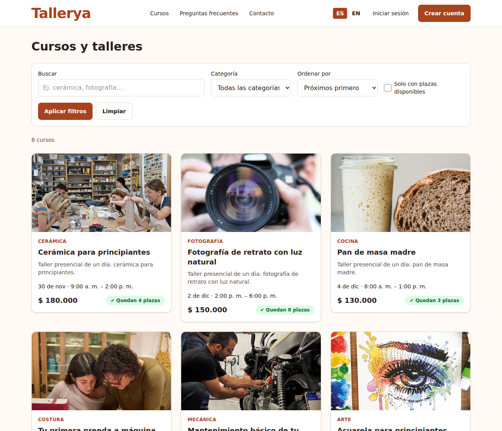
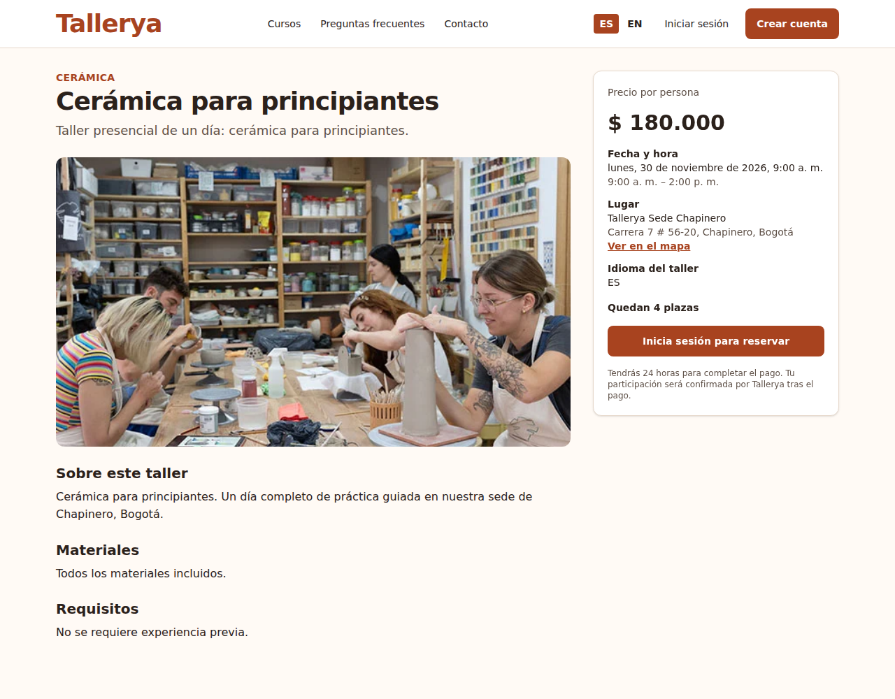
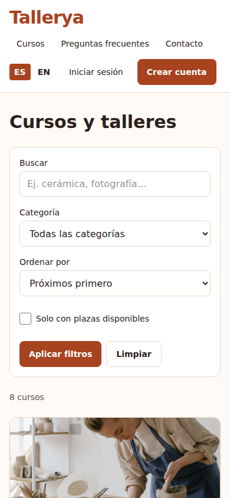

# Tallerya

Plataforma web para una academia de **talleres presenciales de un día en Bogotá**: catálogo, reservas con control de cupos, pagos, aprobación por el propietario, comisiones, notificaciones y panel de administración. Sustituye progresivamente la gestión en Excel.

> Proyecto de ingeniería full stack. Los requisitos, supuestos y preguntas abiertas al cliente están en [`docs/00-discovery/analisis.md`](docs/00-discovery/analisis.md). Cada decisión importante tiene un ADR en [`docs/adr/`](docs/adr).

[](https://github.com/4GeeksAcademy/ejercicio-proyecto-desde-cero/actions/workflows/ci.yml)

## Demo en vivo
**https://tallerya-web.onrender.com** · API: https://tallerya-api.onrender.com/docs (si la documentación está habilitada)

> Está en el plan gratuito de Render: **se duerme tras ~15 min sin visitas** y la primera carga puede tardar hasta un minuto. Los pagos son **simulados** (no se cobra nada) y no se envían correos.

| Catálogo (ES/EN, filtros, disponibilidad) | Ficha del curso (SEO, JSON-LD) | Móvil |
|---|---|---|
|  |  |  |

## Arquitectura

```mermaid
flowchart LR
    U[Navegador / buscador / asistente IA] -->|HTTPS| W[Next.js<br/>TypeScript · Tailwind · i18n]
    W -->|/api/* proxy, cookies same-site| A[FastAPI<br/>monolito modular]
    P[Pasarela de pagos] -->|webhook firmado| A
    A --> D[(PostgreSQL<br/>public + analytics)]
    A -->|outbox transaccional| K[Worker<br/>caducidad · avisos · analítica]
    K --> D
    A -. trazas y métricas .-> O[OpenTelemetry → Grafana]
    W -. llms.txt · sitemap · JSON-LD .-> U
```

## Estado

| Hito | Estado |
|---|---|
| 0 Discovery · 1 Base/Docker · 2 BD + migraciones · 3 Auth/RBAC · 4 Cursos · 5 Reservas · 6 Pagos/comisión | ✅ hecho y probado |
| 7 Notificaciones + QR · 9 Worker asíncrono | ✅ (WhatsApp y función exacta del QR: pendientes del cliente) |
| 8 Frontend (i18n, SEO, a11y, admin) · 12 Tests (unit/integración/E2E) | ✅ |
| 10 Telemetría (OpenTelemetry: trazas + métricas + logs con `trace_id`) · 11 Pipeline de analítica | ✅ (verificado hasta Tempo/Prometheus) |
| 15 Asistente IA | 🟡 capa de herramientas de solo lectura lista y probada; **falta integrar el modelo** ([ADR-0007](docs/adr/0007-asistente-ia.md)) |
| 14 CI | ✅ **en verde en GitHub** (backend, frontend, seguridad y Docker) |
| 16 Despliegue en Render (`render.yaml`, probado simulándolo en local) | ✅ listo para desplegar: [docs/despliegue.md](docs/despliegue.md) |
| 13 Rendimiento medido y optimizado (Lighthouse móvil: portada 94, catálogo 99, accesibilidad 100) | ✅ [docs/rendimiento.md](docs/rendimiento.md) |
| Dominio propio · pagos y correo reales · fotos alojadas en el proyecto | ⏳ pendientes |

## Arquitectura

```
Navegador ──► Next.js (TS, Tailwind, next-intl)  ──/api/*──►  FastAPI (monolito modular)  ──►  PostgreSQL
                                                                  │                              ▲
Pasarela de pagos ──webhook firmado──►  /payments/webhooks        └── outbox (domain_events) ──► Worker ──► emails / notificaciones / caducidad
```

- **Frontend:** Next.js 16 (App Router), TypeScript, Tailwind v4, rutas localizadas (`/es/cursos/…`, `/en/courses/…`), SEO (hreflang, JSON-LD `Event`, sitemap), WCAG (axe en E2E).
- **Backend:** FastAPI, SQLAlchemy 2 async, Alembic, Pydantic v2, argon2id, JWT corto + refresh rotativo en cookies `httpOnly`, CSRF por doble envío.
- **BD:** PostgreSQL 17 con constraints (CHECK, UNIQUE parciales), trigger de auditoría inmutable y bloqueo de fila para cupos.
- **Worker:** consume el outbox transaccional, caduca reservas, envía emails con reintentos.

### Garantías clave (y dónde se prueban)
| Garantía | Cómo | Test |
|---|---|---|
| Nunca sobrevender | `SELECT … FOR UPDATE` + índice único parcial + idempotencia ([ADR-0004](docs/adr/0004-concurrencia-de-cupos.md)) | `test_bookings.py` (25–30 contendientes) |
| Estados de reserva válidos | máquina de estados pura + historial | `test_state_machine.py` |
| Webhooks seguros | firma HMAC, anti-replay, dedupe, verificación con la pasarela ([ADR-0006](docs/adr/0006-pagos-desacoplados.md)) | `test_payments.py` |
| Dinero exacto | enteros + puntos básicos, `CHECK(comisión+neto=bruto)` | `test_commission_and_config.py` (Hypothesis) |
| Sin tarjetas | checkout alojado por el proveedor | `test_no_card_data_columns_exist` |

## Puesta en marcha

Requisitos: Docker (Compose v2). Para desarrollo local: Python 3.12 + [uv](https://docs.astral.sh/uv/) y Node 24.

```bash
python3 scripts/init_env.py          # crea .env con secretos aleatorios (no se sube a Git)
docker compose up -d --build         # db, migraciones, backend, worker, frontend, mailpit
docker compose exec backend python -m app.cli seed-demo      # cursos de demostración
TALLERYA_PASSWORD='<elige-una>' docker compose exec -e TALLERYA_PASSWORD backend \
  python -m app.cli create-user --email tu@correo.co --name "Tu Nombre" --phone +573001234567 --role OWNER
```

| Servicio | URL |
|---|---|
| Web | http://localhost:3000 |
| API + documentación OpenAPI | http://localhost:8000/docs |
| Correos de desarrollo (Mailpit) | http://localhost:8025 |

El pago usa un **proveedor simulado** (`PAYMENT_PROVIDER=fake`): en la pantalla de pago hay botones para simular éxito o fallo. En `staging/production` la aplicación se niega a arrancar con el proveedor `fake` o con secretos por defecto.

### Observabilidad (opcional)
`docker compose --profile observability up -d` levanta Grafana (http://localhost:3001, `admin/admin` solo en desarrollo). Con `OTEL_ENABLED=true` y `OTEL_EXPORTER_OTLP_ENDPOINT=http://lgtm:4318` en `.env`, el backend envía trazas y métricas. Analítica de negocio: `/api/v1/admin/analytics`; reconstruirla: `python -m app.cli rebuild-analytics`.

## Variables de entorno
Ver [`.env.example`](.env.example). Nunca subas `.env`. `JWT_SECRET` y `PAYMENT_WEBHOOK_SECRET` son obligatorios fuera de desarrollo.

## Tests y calidad

```bash
docker compose up -d db
cd backend  && POSTGRES_HOST=localhost uv run pytest --cov=app   # 158 tests, ~94 % cobertura (PostgreSQL real)
            && uv run ruff check . && uv run mypy app
cd frontend && npm run lint && npm run typecheck && npm test      # unit + i18n
            && npm run e2e                                         # 11 pruebas en navegador; requiere el stack levantado y un admin (ver e2e/)
```
E2E: `E2E_ADMIN_EMAIL` / `E2E_ADMIN_PASSWORD` apuntan a un usuario con rol ADMIN; `npx playwright install chromium` la primera vez.

### Contrato API → tipos del frontend
```bash
cd backend && uv run python -c "import json; from app.main import app; print(json.dumps(app.openapi()))" > ../frontend/openapi.json
cd ../frontend && npm run api:types
```

## Base de datos
Migraciones con Alembic (`backend/migrations`). `alembic upgrade head` al arrancar (servicio `migrate`). El CI comprueba que no haya desviaciones entre modelos y migraciones (`alembic check`).
**Backups:** `scripts/backup.sh` crea un volcado y `scripts/restore-check.sh <archivo>` lo restaura en una BD temporal y verifica la integridad (reservas huérfanas/duplicadas, sobreventa, comisiones). Un backup no es válido hasta que ese script pasa. Frecuencia, retención, cifrado y copia fuera del servidor: **[PENDIENTE]** al elegir hosting.

## Estructura
```
backend/app/{core,api,modules/*,worker}  backend/migrations  backend/tests
frontend/{app,components,i18n,messages,lib,e2e,tests}
docs/{00-discovery,adr,hitos}   scripts/   .github/workflows
```

## Seguridad (resumen)
Contraseñas con argon2id · cookies `httpOnly`/`SameSite` + CSRF · bloqueo por intentos y rate limiting · RBAC + propiedad del recurso (404 en reservas ajenas) · auditoría inmutable · errores sin stack traces · logs JSON sin secretos · escaneo de dependencias y secretos en CI.

## Pendiente del cliente (bloquea producción)
Proveedor de pagos y moneda · quién recibe el 20 % · política de reembolsos · función exacta del QR y WhatsApp · grabaciones y consentimiento · textos legales (privacidad/términos) y requisitos fiscales en Colombia. Detalle en el análisis (punto 12).

## Producción: lo que NO debe olvidarse
- `COOKIE_SECURE=true`, `JWT_SECRET` y `PAYMENT_WEBHOOK_SECRET` propios y un proveedor de pagos real: la aplicación **se niega a arrancar** en staging/producción si falta alguno.
- No publicar el puerto 8000 del backend. Poner delante un proxy inverso real (Nginx, Caddy o balanceador) y entonces `TRUSTED_PROXY_HOPS=1` para que el límite de intentos sea por cliente. **Con el proxy de Next solamente, déjalo en 0**: Next no añade `X-Forwarded-For` y el cliente podría falsificarlo.
- Dominio público con HTTPS y `NEXT_PUBLIC_SITE_URL` / `FRONTEND_URL` ([docs/seo-y-agentes.md](docs/seo-y-agentes.md)).

## Troubleshooting
- *Tests: «PostgreSQL no disponible»* → `docker compose up -d db`.
- *La web sale sin estilos* → no quites la regla de Turbopack de `frontend/next.config.ts` (carga Tailwind).
- *Tras reiniciar el entorno los contenedores están `Exited`* → ahora tienen `restart: unless-stopped` y vuelven solos; si no, `docker compose up -d`.
- *Error `parent snapshot ... does not exist` al construir* (Docker pierde su caché tras un reinicio) → `docker builder prune -af` y repetir. Si un contenedor da `RWLayer ... nil`: `docker compose down` (sin `-v`, conserva los datos) y `docker compose up -d`.
