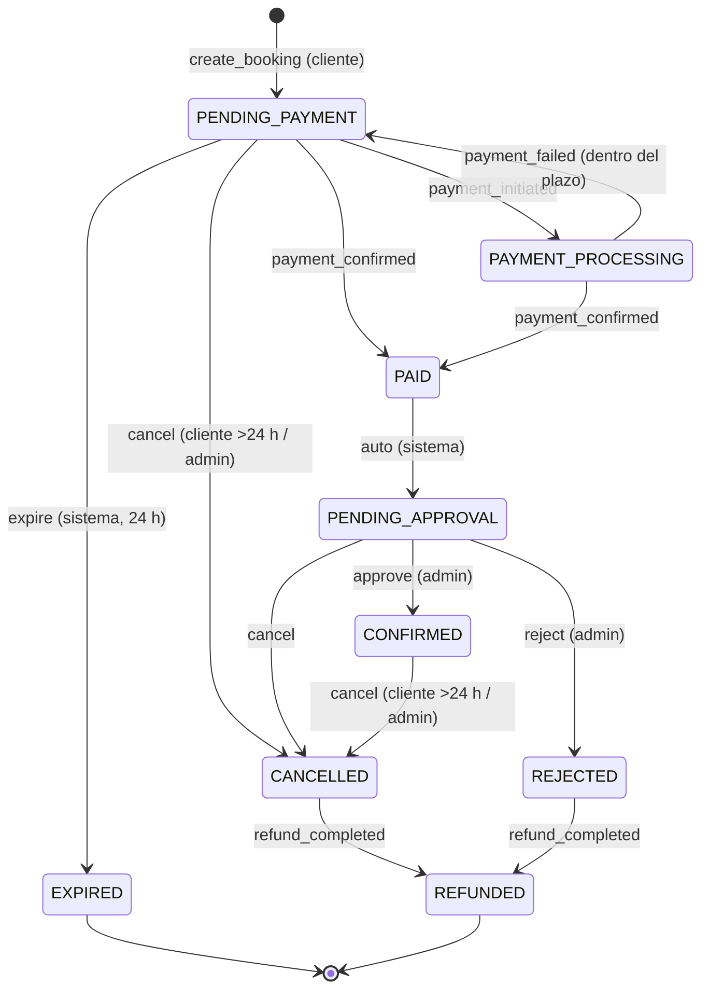
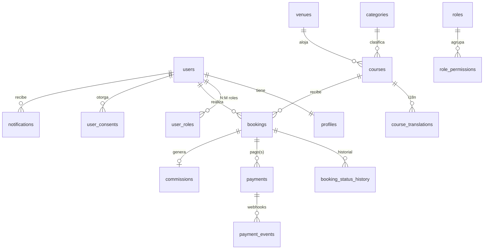

# TALLERYA — Análisis profesional (HITO 0)

> **Versión inicial del análisis (20-11-2026), con un anexo de actualización (21-11-2026).** El cuerpo de este documento es el análisis que se aprobó **antes** de programar; no se reescribe para que se vea el razonamiento original. El **Anexo A** (al final) recoge qué se construyó, qué decisiones cambiaron y qué resultados se midieron. Donde el cuerpo y el anexo discrepan, **manda el anexo**.
> **Etiquetas** (regla 58): **[CLIENTE]** pedido expreso · **[REGLA]** derivada directamente · **[PROPUESTA]** mejora recomendada · **[TÉCNICO]** decisión de arquitectura · **[PENDIENTE]** requiere confirmación.

---

## 1. Executive Summary

Tallerya es una academia de talleres presenciales de un día en Bogotá que hoy gestiona reservas con Excel. Construiremos una plataforma web (catálogo, registro, reserva, pago, aprobación, administración) con un **monolito modular**: **Next.js + TypeScript + Tailwind** (frontend, SEO), **FastAPI** (API y reglas de negocio), **PostgreSQL** (datos y control de concurrencia), un **worker** para tareas en segundo plano y **OpenTelemetry** para observabilidad, todo en **Docker**.

Los tres puntos que determinan si el proyecto es "real" o "de demostración":
1. **No sobrevender cupos** (concurrencia en PostgreSQL, probada con tests paralelos).
2. **Máquina de estados de reservas** estricta con historial y auditoría.
3. **Pagos desacoplados** (puerto/adaptador) con webhooks seguros e idempotentes.

Hay 6 decisiones de negocio que bloquean hitos concretos (proveedor de pagos, quién recibe el 20 %, política de reembolsos, procedimiento de aprobación, QR/WhatsApp, requisitos legales). Se ordenan en el punto 12 por el hito que bloquean: se puede avanzar con los Hitos 1–5 sin ellas.

## 2. Problem Statement

La operación en Excel obliga a procesos manuales para registrar participantes, contar cupos, saber quién pagó, cancelar, crear/desactivar cursos y consultar clientes. Esto causa: riesgo de sobreventa y errores humanos, ningún control de acceso ni trazabilidad, imposibilidad de que el cliente reserve solo (24/7), nula visibilidad en buscadores, y ninguna métrica del negocio. Crece mal: cada curso/persona nueva aumenta el trabajo manual.

## 3. Objetivos de Tallerya

**Negocio [CLIENTE]:** digitalizar reservas, cupos, pagos y comisiones; ser encontrable por Internet; reemplazar Excel progresivamente.
**Producto:** que el cliente siempre sepa qué pasa con su reserva y su pago; que el propietario apruebe participantes con un clic.
**Aprendizaje [CLIENTE-desarrolladora]:** un proyecto demostrable de Full Stack + AI Engineering aplicando tus conocimientos, con razonamiento de arquitectura (ADRs), no solo código.

**Objetivos medibles de éxito (propuestos, [PROPUESTA]):** 0 sobreventas en el test de concurrencia (N=50 intentos simultáneos, 1 plaza); 100 % de reservas con historial de estados; reserva end-to-end en ≤ 5 pasos; reemplazo total de la hoja Excel para cursos nuevos tras el piloto.

## 4. Stakeholders

| Stakeholder | Interés | Notas |
|---|---|---|
| Propietario / dueño de Tallerya | Aprobar participantes, comisiones, métricas | Decide las preguntas pendientes |
| Administradores / staff | Operación diaria de cursos y reservas | Rol ADMIN |
| Clientes / alumnos | Reservar y pagar fácil | Español e inglés |
| Instructores | Futuro (rol INSTRUCTOR) | Datos pendientes [PENDIENTE] |
| Tú (desarrolladora) | Aprender y demostrar | Decides y revisas todo el código |
| Coding Agent (yo) | Scaffolding, tests, docs, revisión | Nunca acepta cambios sin tu revisión |
| Proveedor de pagos / WhatsApp / email | Integraciones | Por elegir [PENDIENTE] |
| Asesor legal/fiscal | Datos personales, retracto, facturación en Colombia | Antes de producción |

## 5. Alcance (versión 1)

Catálogo público con búsqueda/filtros/categorías · i18n ES/EN · registro/login/recuperación · reserva individual con control de cupos · pago con proveedor externo · aprobación por admin · cancelación y caducidad · comisión configurable (20 %) · notificaciones · QR/WhatsApp (según confirmación) · panel admin (cursos, reservas, pagos, usuarios, comisiones, métricas, auditoría) · observabilidad · pipeline de eventos → métricas · CI/CD con Docker · SEO · asistente IA **solo lectura** (Hito 15, si se aprueba).

## 6. Fuera de alcance inicial

Multi-academia/multi-tenant · cursos de varios días o recurrentes · lista de espera · reservas grupales/varias plazas · cupones y descuentos · app móvil nativa · marketplace de instructores · facturación electrónica DIAN integrada (solo se prepara el modelo) · transmisión en vivo · el asistente IA realizando reservas/pagos · Kafka, Kubernetes, microservicios. Todo se **prepara** (modelo extensible) sin construirse.

## 7. Requisitos del cliente confirmados [CLIENTE]

C-01 Talleres presenciales de un solo día en Bogotá · C-02 Categorías: fotografía, mecánica, cocina, costura, cerámica, arte, manualidades, futuras · C-03 Capacidad **por curso** · C-04 Una reserva = una persona · C-05 No reservar cursos llenos/inactivos/cancelados/finalizados · C-06 No reservar ni cancelar con <24 h para el inicio · C-07 24 h máximo para pagar, luego caduca · C-08 El propietario acepta al participante tras el pago · C-09 Comisión del 20 % (configurable) · C-10 ES e EN · C-11 Registro: nombre, email, teléfono, contraseña, idioma · C-12 Marketing opcional, nunca preseleccionado · C-13 Roles visitante/cliente/admin/propietario (+ instructor futuro) · C-14 Encontrable en Google/asistentes · C-15 WhatsApp y QR en el proceso de reserva (detalle pendiente) · C-16 Algunos cursos pueden grabarse para YouTube · C-17 Reemplazar Excel.

## 8. Requisitos funcionales (resumen)

- **RF-AUTH:** registro, login, logout, recuperación, sesiones, rutas protegidas, RBAC.
- **RF-USR:** perfil, idioma, consentimientos (obligatorios vs. marketing, con registro versionado), eliminación/modificación de datos.
- **RF-CAT:** catálogo con búsqueda, categorías, filtros, orden, "próximos", detalle con disponibilidad y ubicación.
- **RF-CUR (admin):** crear/editar/activar/desactivar/cancelar curso; campos de la sección 9 del prompt; imágenes.
- **RF-BOOK:** crear reserva (1 persona), ver mis reservas, cancelar, caducidad automática, aprobar/rechazar (admin), historial de estados.
- **RF-PAY:** iniciar pago, recibir webhook, estado del pago, reembolso (según política), comisión por reserva.
- **RF-NOT:** notificaciones transaccionales (confirmación, recordatorio, caducidad, aprobación/rechazo), preferencias.
- **RF-ADM:** dashboard de negocio, gestión de usuarios/clientes, comisiones, auditoría.
- **RF-OPS:** health/ready, métricas, logs, trazas.
- **RF-SEO/I18N:** URLs localizadas, sitemap, metadatos, datos estructurados.
- **RF-AI (futuro):** búsqueda de cursos en lenguaje natural con herramientas de solo lectura.

## 9. Requisitos no funcionales (objetivos medibles)

Son **[PROPUESTA]**, no SLA del cliente. Todos "PENDIENTE DE CONFIRMAR" como compromiso contractual.

| Área | Objetivo propuesto | Cómo se mide |
|---|---|---|
| Seguridad | OWASP ASVS nivel 1 como checklist; 0 vulnerabilidades críticas/altas conocidas en dependencias; 0 secretos en el repo | `pip-audit`, `npm audit`, Trivy, gitleaks en CI |
| Rendimiento | p95 lecturas API < 300 ms; p95 crear reserva < 800 ms; LCP < 2,5 s en 4G móvil | Métricas OTel, Lighthouse CI |
| Disponibilidad | Objetivo interno 99,5 % mensual (sin SLA al cliente) | Healthcheck externo + métricas |
| Mantenibilidad | Lint/types sin errores; dominios sin imports cruzados indebidos | ruff, mypy, import-linter |
| Observabilidad | 100 % requests con `request_id`/`trace_id`; logs JSON sin datos sensibles | Tests de logging + revisión |
| Accesibilidad | WCAG 2.2 AA en flujos principales | axe en E2E + revisión manual de teclado |
| Escalabilidad | Soportar 10× la carga estimada inicial sin reescritura (estimación [PENDIENTE]) | Prueba de carga con k6 |
| Recuperación | RPO ≤ 24 h, RTO ≤ 4 h (valores a ajustar con el cliente) | Simulacro de restauración documentado |
| Testabilidad | ≥ 80 % cobertura en dominio de reservas/pagos; 100 % de casos críticos del punto 34 cubiertos | pytest-cov, CI |

## 10. Reglas de negocio

| ID | Regla | Tag |
|---|---|---|
| RN-01 | Cada curso tiene su capacidad; nunca hay capacidad global | [CLIENTE] |
| RN-02 | Una reserva = una persona | [CLIENTE] |
| RN-03 | Solo se reserva si el curso está publicado/activo, no cancelado, no finalizado y con cupo | [CLIENTE] |
| RN-04 | No se crean reservas si faltan < 24 h para `starts_at` | [CLIENTE] |
| RN-05 | Cancelar solo si faltan > 24 h | [CLIENTE] |
| RN-06 | Reserva sin pago no es plaza confirmada | [CLIENTE] |
| RN-07 | Plazo máximo de pago: 24 h; luego `EXPIRED` | [CLIENTE] |
| RN-08 | Tras el pago, el propietario aprueba (`CONFIRMED`) o rechaza | [CLIENTE] |
| RN-09 | Un usuario no puede tener dos reservas activas del mismo curso | [REGLA] (evitar duplicados) |
| RN-10 | Cupos ocupados = reservas en estados que **consumen plaza** (ver punto 18); nunca negativos | [REGLA] |
| RN-11 | Comisión = `round(precio × bps / 10000)`; neto = precio − comisión; snapshot al momento del pago | [PROPUESTA] sobre C-09 |
| RN-12 | Dinero en enteros de unidad mínima + moneda ISO 4217; nunca `float` | [TÉCNICO] |
| RN-13 | Plazo de pago = creación + 24 h. Como solo se reserva con >24 h de antelación, el plazo siempre termina ANTES del inicio. *(Corregido en H5: la versión anterior de este análisis lo planteaba mal.)* | [REGLA] |
| RN-14 | Un pago que llega tras la caducidad no confirma plaza; se trata como anomalía (reembolso/revisión) | [PROPUESTA] / [PENDIENTE] |
| RN-15 | Reserva en `PAYMENT_PROCESSING` no caduca hasta que el proveedor resuelva (con tope) | [PROPUESTA] |
| RN-16 | Reducir capacidad de un curso por debajo de reservas activas está prohibido | [REGLA] |
| RN-17 | Cancelar un curso (admin) cancela todas sus reservas y dispara reembolso | [REGLA] / [PENDIENTE] política |
| RN-18 | Toda lógica crítica vive en backend | [CLIENTE] |

## 11. Suposiciones detectadas

S-01 Un "curso" es **un evento único con fecha** (si el mismo taller se repite cada mes, cada fecha es un curso nuevo; ver P-07). · S-02 La moneda es COP. · S-03 Los 24 h se cuentan sobre el `starts_at` real en zona `America/Bogotá`. · S-04 "Aprobación" es manual por el propietario/admin (existe `PENDING_APPROVAL`). · S-05 Una plaza en `PENDING_PAYMENT` ya reserva el cupo durante la ventana de pago (si no, habría sobreventa al pagar). · S-06 El precio incluye impuestos. · S-07 Solo adultos (sin menores). · S-08 La hoja Excel actual es importable (datos históricos a migrar es opcional). · S-09 Un solo negocio/ciudad inicial. · S-10 Email como canal transaccional mínimo.

## 12. Preguntas pendientes para el cliente

Ordenadas por el hito que bloquean. **Los Hitos 1–5 no dependen de ellas.**

| # | Pregunta | Bloquea |
|---|---|---|
| P-01 | ¿Quién recibe exactamente el 20 %? (¿Tallerya retiene 20 % y paga 80 % al instructor/dueño del taller? ¿el propietario cobra comisión sobre cursos de terceros?) | H6 (contabilidad) |
| P-02 | Proveedor de pagos (candidatos a verificar disponibilidad: Wompi, Mercado Pago, PayU, ePayco; Stripe no asumir) y moneda definitiva | H6 |
| P-03 | Matiz real (corrige la versión anterior): quien reserva a T−25 h puede pagar hasta T−1 h, es decir, DENTRO de la ventana en que ya no se puede cancelar y con poco margen para que el propietario apruebe. ¿Se acorta el plazo de pago (p. ej. hasta T−24 h) o se acepta? Hoy: se acepta (24 h fijas, configurable). | H5 (no bloquea) |
| P-04 | Si el cliente pagó y el propietario rechaza: ¿reembolso total/parcial/crédito? | H6 |
| P-05 | Política de reembolsos (cliente cancela >24 h, curso cancelado por Tallerya, rechazo) y retracto del consumidor | H6 |
| P-06 | Procedimiento de aprobación: ¿manual siempre o automático por curso? ¿quién aprueba? ¿plazo máximo antes de reembolso automático? | H5/H6 |
| P-07 | ¿El mismo taller se repite en varias fechas? (afecta el modelo: curso vs. sesión) | H2 |
| P-08 | Función exacta del QR (acceso/check-in, recibo, enlace de pago) | H7 |
| P-09 | Funcionamiento de WhatsApp (solo enlace "hablar con nosotros", o mensajes automáticos con plantillas aprobadas) | H7 |
| P-10 | Canales de notificación (email, WhatsApp, in-app) y proveedor de email | H7 |
| P-11 | Grabaciones: ¿quién decide, qué consentimiento firman los alumnos, quién accede (solo asistentes, público, no listado)? | H4 (campos) / H16 |
| P-12 | Datos de instructores (¿se muestran? foto, bio, consentimiento) | H4 |
| P-13 | ¿Hay menores de edad como participantes? | H3 |
| P-14 | Política de privacidad, términos, conservación de datos, RNBD/habeas data | H13/H16 |
| P-15 | Facturación: ¿factura electrónica DIAN por reserva? ¿IVA incluido? | H6/H16 |
| P-16 | Dirección(es) y datos del lugar; ¿mismo lugar siempre? | H4 |
| P-17 | Capacidad de pago de infraestructura (hosting, dominio, observabilidad gestionada) | H14 |
| P-18 | Datos del Excel actual: ¿migrar? ¿qué columnas? | H4/H16 |

## 13. Roles y permisos (RBAC)

Modelo con tablas `roles`, `permissions`, `role_permissions`, `user_roles`. "Visitante" no es un rol en BD: es la ausencia de sesión. Los permisos se verifican en backend por dependencias de FastAPI (`require_permission("course:write")`).

| Permiso | Visitante | Cliente | Admin | Propietario |
|---|:-:|:-:|:-:|:-:|
| Ver/buscar cursos y disponibilidad | ✔ | ✔ | ✔ | ✔ |
| Registrarse / login | ✔ | – | – | – |
| Perfil propio, reservar, pagar, cancelar propia | – | ✔ | ✔* | ✔* |
| Ver reservas **propias** | – | ✔ | ✔ | ✔ |
| Ver reservas/clientes de **todos** | – | ✘ | ✔ | ✔ |
| CRUD cursos, activar/desactivar/cancelar | – | ✘ | ✔ | ✔ |
| Aprobar/rechazar reservas, comprobar pagos | – | ✘ | ✔ | ✔ |
| Estadísticas operativas | – | ✘ | ✔ | ✔ |
| Gestionar administradores y permisos | – | ✘ | ✘ | ✔ |
| Comisiones, configuración general, auditoría | – | ✘ | lectura limitada [PENDIENTE] | ✔ |
| Observabilidad técnica | – | ✘ | ✘ | ✔ |
| (Futuro) INSTRUCTOR: ver sus cursos y asistentes | – | – | – | – |

\*Un admin también puede ser cliente de su propia cuenta. Regla de oro: **autorización por recurso** (¿esta reserva es tuya?) además de por rol → previene IDOR.

## 14. Historias de usuario (principales)

**Visitante:** HU-01 ver catálogo · HU-02 buscar y filtrar por categoría/fecha/precio/idioma · HU-03 ver detalle con cupos y mapa · HU-04 registrarme eligiendo idioma y consentimientos · HU-05 iniciar sesión / recuperar contraseña.
**Cliente:** HU-06 reservar un taller · HU-07 pagar y ver estado del pago · HU-08 ver mis reservas y su estado claro · HU-09 cancelar si faltan >24 h · HU-10 recibir confirmación/recordatorios · HU-11 gestionar perfil, preferencias y consentimiento de marketing · HU-12 pedir eliminación de mis datos.
**Admin/propietario:** HU-13 crear/editar/desactivar/cancelar curso · HU-14 ver reservas por curso y cupos · HU-15 aprobar o rechazar participantes pagados · HU-16 verificar pagos · HU-17 ver clientes · HU-18 ver comisiones (propietario) · HU-19 ver dashboard de negocio · HU-20 consultar auditoría · HU-21 gestionar administradores (propietario) · HU-22 ver salud técnica del sistema (propietario).
**Futuro:** HU-23 preguntar al asistente "algo creativo este fin de semana" y recibir cursos reales.

## 15. Criterios de aceptación (casos críticos, formato Dado/Cuando/Entonces)

- **HU-06 Reserva exitosa:** Dado un curso publicado con cupo y >24 h, cuando un cliente autenticado reserva, entonces se crea reserva `PENDING_PAYMENT` con `expires_at`, el cupo disponible baja en 1 y se registra historial.
- **HU-06 Sin autenticar:** cuando un visitante intenta reservar → 401 y nada se crea.
- **HU-06 Última plaza concurrente:** con 1 plaza y N peticiones simultáneas, exactamente 1 recibe 201; el resto 409 `COURSE_FULL`; ocupados nunca > capacidad.
- **HU-06 Duplicado:** la misma persona reservando dos veces el mismo curso → 409 `ALREADY_BOOKED`; reintento con la misma `Idempotency-Key` devuelve la misma reserva.
- **HU-06 Reglas de curso:** curso lleno/inactivo/cancelado/finalizado o <24 h → 409/422 con código de error de negocio específico.
- **HU-09 Cancelación:** >24 h → `CANCELLED` y cupo liberado; ≤24 h → 409 `CANCELLATION_WINDOW_CLOSED`.
- **RN-07 Caducidad:** reserva `PENDING_PAYMENT` pasadas 24 h → `EXPIRED`, cupo liberado, notificación; funciona aunque el worker esté caído (la disponibilidad ignora holds vencidos).
- **Pago:** webhook válido → pago `PAID`, reserva → `PENDING_APPROVAL`, comisión registrada; webhook duplicado → 200 sin efectos dobles; firma inválida → 401 y evento descartado/registrado; pago fallido → reserva vuelve a `PENDING_PAYMENT` mientras dure el plazo.
- **Aprobación (HU-15):** solo admin/propietario; `PENDING_APPROVAL → CONFIRMED` genera auditoría y notificación; cliente intentando → 403.
- **Acceso ajeno:** cliente A consultando reserva de B → 404 (no revelar existencia); cliente en `/admin/*` → 403.
- **Comisión:** 100 000 COP al 20 % → 20 000 + 80 000; casos con redondeo cubiertos; `comisión + neto = precio` siempre.
- **Notificación falla:** la reserva no se revierte; el job reintenta con backoff y queda registrado.
- **Consentimiento:** casilla de marketing inicia desmarcada; se registra versión del texto, fecha y canal.

## 16. Flujo completo del cliente

```
Google/Asistente → Home/Catálogo → Filtrar → Detalle (cupos, ubicación, precio)
→ [¿sesión?] No → Registro/Login (vuelve al curso) → "Reservar"
→ Reserva creada (PENDING_PAYMENT, cuenta regresiva 24 h) → Pago (proveedor)
→ "Pago recibido, esperando aprobación" (PENDING_APPROVAL)
→ Aprobada: confirmación + QR (+WhatsApp) → recordatorio → Asiste al curso
Alternativas: no paga → EXPIRED · cancela (>24 h) → CANCELLED (+reembolso según política) · rechazada → REJECTED/REFUNDED
```
UX [CLIENTE]: la pantalla "Mis reservas" siempre muestra estado de reserva, estado de pago, **qué debe hacer ahora** y cuánto tiempo le queda.

## 17. Flujo completo de una reserva (técnico)

1. `POST /api/v1/bookings` con `Idempotency-Key`.
2. Backend abre **una transacción**: bloquea la fila del curso (`SELECT … FOR UPDATE`), valida reglas (publicado, no pasado, >24 h, no duplicado), cuenta plazas ocupadas, y si hay cupo inserta la reserva `PENDING_PAYMENT` + historial + pago `PENDING`. Commit.
3. Respuesta 201 con `expires_at`.
4. Cliente inicia pago → `POST /bookings/{id}/pay` → el proveedor devuelve URL/token de checkout.
5. Webhook del proveedor → verificación → pago `PAID` → reserva `PAID → PENDING_APPROVAL` (misma transacción) + comisión + evento de dominio en la tabla outbox.
6. Admin aprueba → `CONFIRMED` + auditoría + job de notificación/QR.
7. Job periódico de caducidad marca `EXPIRED`; además **cada consulta de cupos filtra por `expires_at > now()`**, así que la corrección no depende del worker.

**Concurrencia explicada sencillo:** imagina una sola llave de la puerta de la sala. `FOR UPDATE` es esa llave: quien llega primero entra, cuenta cuántos hay y se sienta; el segundo espera unos milisegundos y, al entrar, ya ve la sala llena. Una **restricción única parcial** en BD `(course_id, user_id) WHERE status IN (consumen plaza)` es el cinturón de seguridad que impide duplicados incluso si el código falla, y la `Idempotency-Key` hace que un doble clic no cree dos reservas.

## 18. Máquina de estados de reservas

Estados que **consumen plaza**: `PENDING_PAYMENT` (mientras `expires_at` no venza), `PAYMENT_PROCESSING`, `PAID`, `PENDING_APPROVAL`, `CONFIRMED`. No consumen: `REJECTED`, `CANCELLED`, `EXPIRED`, `REFUNDED`. Estado inicial: `PENDING_PAYMENT`. Terminales: `EXPIRED`, `REFUNDED` (y `CANCELLED`/`REJECTED` si nunca hubo pago).



| Transición | Evento | Quién | Guardas | Efectos secundarios |
|---|---|---|---|---|
| ∅→PENDING_PAYMENT | `booking_created` | Cliente | Reglas RN-03/04/09/10 | Reserva de plaza, `expires_at`, pago PENDING, email |
| →PAYMENT_PROCESSING | `payment_initiated` | Sistema | pago PROCESSING | — |
| →PENDING_PAYMENT (retorno) | `payment_failed` | Sistema | `expires_at` futuro | Notificar fallo, permitir reintento |
| →PAID | `payment_confirmed` | **Solo sistema** (webhook verificado) | Monto/moneda coinciden | Registrar comisión, evento outbox |
| PAID→PENDING_APPROVAL | `awaiting_approval` | Sistema | — | Aviso a admin |
| →CONFIRMED | `booking_approved` | Admin/Propietario | Curso no cancelado | Auditoría, QR, notificación al cliente |
| →REJECTED | `booking_rejected` | Admin/Propietario | Motivo obligatorio | Auditoría, iniciar reembolso [PENDIENTE] |
| →EXPIRED | `booking_expired` | Sistema | `expires_at` vencido y no PROCESSING | Libera plaza, notificación |
| →CANCELLED | `booking_cancelled` | Cliente (>24 h) / Admin (cualquier momento, con motivo) | Regla RN-05 | Libera plaza; si pagó, iniciar reembolso |
| →REFUNDED | `refund_completed` | Sistema (proveedor) | Pago REFUNDED | Auditoría, notificación |

**Prohibido:** salir de `EXPIRED` o `REFUNDED`; `CONFIRMED → PENDING_*`; `PENDING_PAYMENT → CONFIRMED` (saltar pago); que un cliente ejecute `payment_confirmed`, `approve` o `reject`; cualquier cambio directo de columna `status` fuera del servicio de reservas. Implementación: tabla de transiciones permitidas en el dominio + `booking_status_history` (reserva, de, a, evento, actor, motivo, fecha) y un `CHECK`/trigger opcional de defensa.

## 19. Flujo de un pago

Estados de pago: `PENDING → PROCESSING → PAID | FAILED | CANCELLED`; `PAID → REFUNDED`.

```
Cliente → POST /bookings/{id}/pay  → API crea pago (idempotente) y sesión en el proveedor
Cliente paga en página/ widget hospedado del proveedor (Tallerya NUNCA ve tarjeta ni CVV)
Proveedor → POST /api/v1/payments/webhooks/{provider}
   1. Verificar firma (HMAC) y timestamp  → si falla: 401 + log
   2. Guardar payment_event con UNIQUE(provider, provider_event_id)  → duplicado: 200 sin efecto
   3. Encolar job de proceso (responder 2xx rápido)
Worker → consulta estado real al proveedor (no confía solo en el payload) → aplica transición
Job de reconciliación → revisa pagos PROCESSING antiguos contra el proveedor
La página "retorno" del navegador NO es prueba de pago: solo informa.
```
Arquitectura: interfaz `PaymentProvider` (`create_checkout`, `verify_webhook`, `get_status`, `refund`) con un `FakePaymentProvider` para desarrollo/tests y un adaptador real elegido en H6. Importes validados contra el precio del curso (anti-manipulación).

## 20. Arquitectura técnica propuesta

Monolito modular: un único backend desplegable, dominios con límites claros (Auth, Users, Courses, Bookings, Payments, Notifications, Admin, Analytics, Audit). Los dominios se hablan por **funciones de servicio y eventos de dominio**, no leyendo tablas ajenas. Un worker usa el mismo código. Justificación (ADR): equipo de una persona, un solo despliegue, transacciones ACID entre reserva/pago/historial, evolución posterior a servicios si hace falta.

## 21. Diagrama conceptual

```
        Usuario ──► Google / Asistente
           │
           ▼
 ┌────────────────────┐   HTTPS (mismo sitio: /api/* proxied)
 │ FRONTEND Next.js   │──────────────┐
 │ TS · Tailwind · i18n│              ▼
 └────────────────────┘      ┌─────────────────────┐        ┌─────────────┐
                             │ FASTAPI (monolito)  │───────►│ PostgreSQL  │
  Proveedor pagos ──webhook─►│ routers→services→   │◄───────│ (public +   │
  WhatsApp/Email ◄───────────│ repositories        │        │  analytics) │
                             └─────────┬───────────┘        └──────▲──────┘
                                       │ jobs (outbox/cola)        │
                                       ▼                           │
                             ┌─────────────────────┐───────────────┘
                             │ WORKER              │  caducidad · notificaciones ·
                             │ background jobs     │  reconciliación · pipeline
                             └─────────┬───────────┘
        OpenTelemetry (SDK en API/Worker/Front) ▼
                    OTel Collector → Trazas · Métricas · Logs → Grafana
```

## 22. Stack tecnológico recomendado

| Pieza | Elección | Responsabilidad única | Tú | Coding Agent |
|---|---|---|---|---|
| Frontend | **Next.js (App Router) + TypeScript** [TÉCNICO] | Render SSR/ISR para SEO + i18n con rutas `/es`, `/en`. (Una SPA pura con Vite rinde peor en SEO, requisito C-14) | Páginas, flujo de reserva, decisiones UX | Scaffolding, componentes repetitivos |
| Estilos | **Tailwind CSS** + componentes accesibles (Radix/shadcn) | Diseño responsive mobile-first | Sistema de diseño | Variantes, a11y checks |
| i18n | **next-intl** | Traducciones y rutas localizadas | Textos ES/EN | Extraer claves |
| Formularios/datos | React Hook Form + Zod; TanStack Query (zonas autenticadas); cliente tipado generado desde OpenAPI | Validación y contrato único front↔back | Revisar contratos | Generar tipos |
| Backend | **Python + FastAPI + Pydantic v2** | API REST, validación, OpenAPI automático | Reglas de negocio, servicios | Boilerplate de routers/schemas |
| ORM / migraciones | **SQLAlchemy 2.0 + Alembic** (psycopg 3) | Modelos y control de esquema | Modelado, revisión de migraciones | Borradores de migraciones |
| BD | **PostgreSQL** | Transacciones, constraints, locks, índices | Diseño del esquema | Seeds, consultas repetitivas |
| Auth | Propia: **argon2id**, JWT corto + refresh rotativo en cookie httpOnly | Identidad y sesiones | Flujo y seguridad | Tests de seguridad |
| Jobs | **Outbox transaccional + worker con polling a PostgreSQL** (sin librería de colas ni Redis; ver ADR-0005 y Anexo A) | Tareas diferidas, reintentos, periódicas | Diseño de jobs idempotentes | Implementación y tests |
| Observabilidad | **structlog** + **OpenTelemetry** SDK + Collector + Grafana (LGTM) | Logs, métricas, trazas correlacionados | Instrumentar operaciones clave | Configuración de compose/dashboards |
| Calidad | pytest, Hypothesis, Playwright, Vitest, ruff, mypy, ESLint, Prettier | Tests y estilo | Casos críticos | Tests repetitivos |
| Contenedores | Docker, Compose (+ Mailpit para emails de desarrollo) | Entorno reproducible | Entender cada servicio | Dockerfiles multi-stage |
| CI/CD | GitHub Actions, Dependabot, CodeQL, Trivy, gitleaks | Automatización y seguridad | Revisar pipelines | Escribir workflows |
| IA (futuro) | API de Anthropic con *tool use* de solo lectura | Búsqueda en lenguaje natural | Diseño de guardarraíles | Prototipo de herramientas |

**Supabase vs PostgreSQL propio [TÉCNICO]:** recomiendo **PostgreSQL estándar** (Docker en desarrollo; Postgres gestionado en producción, que puede ser el de Supabase *solo como hosting*). Razones: todo acceso pasa por FastAPI, así que RLS duplicaría la autorización; Supabase Auth ocultaría justo lo que quieres aprender y complica el modelo RBAC propio; se evita acoplamiento. Supabase Storage sí puede aportar valor para imágenes de cursos (decisión en H4). Todas las versiones exactas se fijan y verifican en el Hito 1.

## 23. Modelo de datos (resumen por dominio)

Todas las tablas: `id` (UUID), `created_at`, `updated_at`. Dinero: `*_minor` (entero) + `currency` (CHAR(3)). Tiempos: `timestamptz` en UTC; el curso guarda `timezone` (por defecto `America/Bogota`).

**Auth/Users:** `users` (email único case-insensitive, `password_hash`, `is_active`, `email_verified_at`) · `profiles` (nombre, teléfono E.164, `preferred_locale`) · `roles` · `permissions` · `role_permissions` · `user_roles` · `refresh_tokens` (hash, rotación, expiración) · `password_reset_tokens` (hash, un solo uso) · `legal_documents` (tipo, versión, texto) · `user_consents` (usuario, tipo: `terms`/`privacy`/`marketing`, versión, otorgado/revocado, fecha, canal) · `marketing_consents` queda cubierto por `user_consents` o como tabla separada si prefieres (decisión en H3).
**Courses:** `categories` + `category_translations` · `courses` (estado, `starts_at`, `ends_at`, `capacity`, `price_minor`, `currency`, `venue_id`, `category_id`, `instructor_id`, `is_recorded`, `recording_status`, `recording_url`, `requires_approval`) con `CHECK(capacity>0)`, `CHECK(ends_at>starts_at)`, `CHECK(price_minor>=0)` · `course_translations` (locale, nombre, **slug por idioma**, descripciones, materiales, requisitos; `UNIQUE(locale, slug)`) · `course_images` · `venues` (dirección, ciudad, lat/lng, enlace de mapa) · `instructors` (futuro/ opcional).
**Bookings:** `bookings` (course, user, `status`, `expires_at`, `price_minor` snapshot, `currency`) con índice único parcial `(course_id, user_id) WHERE status IN (consumen plaza)` · `booking_status_history` · `qr_tokens` (token opaco aleatorio, hash, vigencia; sin datos personales) · `idempotency_keys` (clave, endpoint, hash de request, respuesta).
**Payments:** `payments` (booking, user, amount_minor, currency, status, provider, transaction_reference; `UNIQUE(provider, transaction_reference)`) · `payment_events` (provider, `provider_event_id`, payload, firma válida, procesado; `UNIQUE(provider, provider_event_id)`) · `commissions` (booking, payment, `gross_minor`, `commission_bps`, `commission_minor`, `net_minor`, estado, beneficiario [PENDIENTE]; `CHECK(commission_minor + net_minor = gross_minor)`) · `app_settings` (comisión por defecto en bps, etc.).
**Notifications:** `notifications` (usuario, tipo, canal, estado, plantilla, intentos) · `notification_preferences`.
**Audit:** `audit_logs` (actor, acción, recurso, `resource_id`, antes/después mínimos, `request_id`, fecha; solo inserción).
**Eventos/Analytics:** `domain_events` (outbox: tipo, payload, `occurred_at`, procesado) · esquema `analytics`: `events`, `fact_bookings`, `fact_payments`, `daily_course_metrics`.

## 24. Entidades y relaciones


Relaciones con integridad: `ON DELETE RESTRICT` en dominios financieros (no se borran reservas/pagos; se anonimiza al usuario si pide eliminación y la ley lo permite).

## 25. Endpoints FastAPI (propuesta)

Prefijo `/api/v1`. Errores con formato uniforme `{code, message, details, request_id}`. Paginación por cursor/`limit+offset`.

- **auth:** `POST /auth/register`, `/login`, `/logout`, `/refresh`, `/forgot-password`, `/reset-password`, `/verify-email`
- **users:** `GET/PATCH /users/me`, `PUT /users/me/consents`, `PUT /users/me/notification-preferences`, `DELETE /users/me` (solicitud de eliminación)
- **categories:** `GET /categories`
- **courses:** `GET /courses` (q, categoría, fecha, precio, idioma, orden, disponibles), `GET /courses/{slug}`, `GET /courses/{id}/availability`
- **bookings:** `POST /bookings`, `GET /bookings` (propias), `GET /bookings/{id}`, `POST /bookings/{id}/cancel`, `POST /bookings/{id}/pay`
- **payments:** `GET /payments` (propios), `POST /payments/webhooks/{provider}`
- **notifications:** `GET /notifications`, `PATCH /notifications/{id}/read`
- **admin:** `POST/PATCH /admin/courses`, `POST /admin/courses/{id}/{activate|deactivate|cancel}`, `GET /admin/bookings`, `POST /admin/bookings/{id}/{approve|reject}`, `GET /admin/payments`, `GET /admin/users`, `GET /admin/commissions`, `GET /admin/metrics`, `GET /admin/audit-logs`, `POST /admin/admins` (propietario)
- **health:** `GET /health` (viva), `GET /ready` (BD y dependencias)
- **assistant (futuro):** `POST /assistant/chat`

## 26. Estructura del repositorio

Se crea **progresivamente** (nada vacío "por aparentar"):

```
tallerya/
├─ frontend/            Next.js: app/[locale]/…, components/, hooks/, services/, types/, lib/
├─ backend/
│  ├─ app/
│  │  ├─ core/          config, db, errors, logging, security
│  │  ├─ modules/       auth/ users/ courses/ bookings/ payments/ notifications/ admin/ analytics/ audit/
│  │  │                 (cada módulo: router, service, repository, models, schemas, events)
│  │  ├─ telemetry/  worker/
│  ├─ migrations/       Alembic
│  └─ tests/            unit/ integration/
├─ database/            seeds, scripts de backup/restore
├─ observability/       otel-collector.yaml, dashboards
├─ tests/e2e/           Playwright
├─ docs/                00-discovery/, adr/, api/, runbooks/
├─ scripts/
├─ .github/             workflows, PR template, CODEOWNERS
├─ docker-compose.yml · .env.example · .gitignore · README.md
```

## 27. Estrategia de Docker

Servicios Compose: `db` (Postgres, volumen `pgdata`, healthcheck `pg_isready`), `migrate` (job one-shot de Alembic), `backend` (healthcheck `/health`, depende de `db` healthy), `worker` (mismo imagen que backend, otro comando), `frontend`, `mailpit` (emails dev), y bajo `profiles: [observability]`: `otel-collector` y `grafana-lgtm`. Redes: `edge` (frontend↔backend) y `internal` (backend↔db; la BD no se publica al host salvo en dev). Dockerfiles *multi-stage*, usuario no-root, versiones fijadas, `.dockerignore`. `.env.example` sin secretos. Dev con *bind mounts* y hot-reload; prod con imágenes inmutables. Explicado línea por línea cuando lo creemos (H1).

## 28. Estrategia de autenticación

Registro con validación + política de contraseña razonable (longitud > composición) · hash **argon2id** · verificación de email [PROPUESTA] · access token JWT corto (≈15 min) + **refresh token opaco rotativo** guardado hasheado en BD, ambos en **cookies httpOnly + Secure + SameSite=Lax** · frontend y API bajo el **mismo sitio** (proxy `/api`) para evitar complicaciones de CORS/CSRF, más token CSRF en operaciones mutables · reset de contraseña con token aleatorio hasheado, un solo uso, expira · rate limit y bloqueo progresivo en login · mensajes que no revelan si un email existe · autorización por dependencias FastAPI (rol/permiso + propiedad del recurso).

## 29. Estrategia de seguridad

Validación estricta con Pydantic · ORM parametrizado (sin SQL por concatenación) · RBAC + comprobación de propiedad (anti-IDOR) · rate limiting (login, registro, reserva, webhooks, asistente IA) · CORS restrictivo · cabeceras (CSP, HSTS, X-Content-Type-Options, frame-ancestors) · secretos solo por variables de entorno/gestor de secretos · usuario de BD de aplicación **con mínimos privilegios** (sin DDL) distinto del de migraciones · webhooks firmados · `audit_logs` inmutables · escaneo: dependabot, `pip-audit`, `npm audit`, Trivy, gitleaks, CodeQL, bandit · errores sin stack trace en producción · logs sin datos sensibles · QR con token opaco · checklist OWASP Top 10/ASVS L1 · pagos con checkout hospedado (alcance PCI mínimo).

## 30. Estrategia de procesamiento asíncrono

Regla: **solo lo que no debe bloquear la petición o necesita reintentos**.

| Trabajo | Disparador | ¿Async? | Nota |
|---|---|---|---|
| Crear reserva / comprobar cupo | Petición | **No** (síncrono, transaccional) | Corrección inmediata |
| Caducar reservas | Periódico (cada minuto) | Sí | La corrección NO depende de él (consulta de cupos filtra `expires_at`) |
| Emails/WhatsApp/notificaciones | Evento de dominio | Sí | Reintentos con backoff; fallo no revierte la reserva |
| Procesar webhooks de pago | Webhook | Sí | Responder 2xx rápido |
| Reconciliar pagos | Periódico | Sí | Contra el proveedor |
| Recordatorios previos al curso | Programado | Sí | 24 h antes (configurable) |
| Pipeline de analítica | Outbox | Sí | Idempotente |
| Informes pesados | Bajo demanda | Sí | Solo si se necesitan |

Patrón: `API → fila en outbox/cola (misma transacción) → WORKER → resultado + registro`. Jobs idempotentes, con reintentos, *dead-letter* y trazas enlazadas al `trace_id` original.

## 31. Estrategia de telemetría

- **Logs:** JSON estructurado (`timestamp, level, service, environment, request_id/trace_id, event, status`); lista negra de campos (password, token, tarjeta…) con redacción automática y test.
- **Trazas:** OpenTelemetry con autoinstrumentación (FastAPI, SQLAlchemy, httpx) + *spans* manuales en `booking.create`, `payment.webhook`, `notification.send`; propagación al worker.
- **Métricas técnicas:** requests, latencia (histograma), status HTTP, errores, duración de consultas, estado de jobs, dependencias externas.
- **Métricas de negocio** ≠ telemetría: se calculan desde eventos de dominio y BD (punto 32), no se mezclan en la misma herramienta de alertas técnicas.
- **Auditoría** ≠ telemetría: tabla `audit_logs` en BD, retención y acceso distintos.
- Dashboard técnico (Grafana) separado del dashboard de negocio (panel admin).

## 32. Estrategia de Data Pipeline

```
Eventos de dominio (outbox en la misma transacción)
→ Worker: validar esquema (Pydantic) → deduplicar por event_id
→ Transformar (enriquecer curso/categoría, normalizar zona horaria)
→ Cargar en esquema analytics (hechos + agregados diarios, idempotente / upsert)
→ API admin/metrics → Dashboard
```
Eventos: `course_viewed`, `booking_created`, `booking_confirmed`, `booking_expired`, `booking_cancelled`, `payment_completed`, `payment_failed`, `course_cancelled`. Mismo PostgreSQL, **esquema separado** (sin Kafka/Airflow/warehouse). `course_viewed` sin datos personales (identificador anónimo/sesión). Soporta *backfill* reprocesando eventos. Honestidad de ingeniería: a la escala inicial bastarían vistas materializadas; el pipeline se justifica por trazabilidad, reproducibilidad y preparación para crecer; ADR lo documenta y define cuándo migrar a un almacén analítico aparte.

## 33. Estrategia de testing

Pirámide: **Unit** (máquina de estados, reglas 24 h con reloj inyectable, cálculo de comisión, permisos) → **Integración** (API + **PostgreSQL real** vía Testcontainers/compose; SQLite no sirve para probar concurrencia) → **E2E** (Playwright: visitante→registro→reserva→pago simulado→aprobación). **Concurrencia:** `asyncio.gather` con N clientes y 1 plaza, repetido. **Propiedades** (Hypothesis): ninguna secuencia de eventos produce una transición inválida ni `ocupados > capacidad`. **Contrato:** esquema OpenAPI versionado, tipos del front generados. **Frontend:** Vitest + Testing Library + axe. **Carga:** k6 sobre reserva/catálogo. Cada hito incluye sus tests (no se dejan para el Hito 12). Casos críticos del punto 34 del prompt: mapeados 1:1 a tests con nombre `test_<regla>`.

## 34. Estrategia Git/GitHub

Trunk-based con ramas cortas (`feat/…`, `fix/…`, `docs/…`), `main` protegida, **PRs aunque trabajes sola** (revisión propia con checklist + revisión del agente), **Conventional Commits**, commits pequeños, plantilla de PR (qué/por qué/cómo se probó/riesgos), issues por hito con criterios de aceptación, `CODEOWNERS`, `.gitignore` y gitleaks para evitar `.env`/secretos. Ciclo por cambio: **PLAN → IMPLEMENT → REVIEW → TEST → COMMIT**; el agente propone, tú entiendes y apruebas.

## 35. Estrategia CI/CD

`push/PR → lint (ruff, ESLint) → type check (mypy, tsc) → tests (BD de servicio) → build → seguridad (pip-audit, npm audit, gitleaks, CodeQL, Trivy) → docker build`. Entornos **development** (local), **staging** (despliegue automático desde `main`, datos ficticios, proveedor de pagos en *sandbox*), **production** (despliegue manual aprobado, migraciones con paso previo de backup). Destino de despliegue [PENDIENTE] (P-17).

## 36. SEO

Estrategia i18n **por prefijo de ruta** (una sola app, sin duplicar páginas): `/es/cursos/ceramica-principiantes`, `/en/courses/beginner-ceramics`, categorías `/es/categorias/ceramica`; slug traducido por idioma (`course_translations`). `/` redirige según `Accept-Language`, `es` por defecto. Renderizado SSR/ISR · `<title>`/meta únicos · canonical · **hreflang** entre idiomas · `sitemap.xml` por idioma (cursos activos y futuros) · `robots.txt` (bloquea `/admin`, cuenta, API) · Open Graph/Twitter · **JSON-LD `Event`** (nombre, fecha, `Place` con dirección, `offers` con precio/disponibilidad, `eventStatus`, `eventAttendanceMode: Offline`) + `Organization` · imágenes optimizadas · cursos finalizados: mantener URL con aviso o redirigir a la categoría · rendimiento mobile-first.

## 37. Accesibilidad

HTML semántico y landmarks · navegación completa por teclado y foco visible · `label` en todos los campos y errores asociados (`aria-describedby`, `aria-live`) · contraste AA · estados de reserva/pago no dependientes solo del color (texto + icono) · `alt` en imágenes informativas · diálogos con trampa de foco (Radix) · `lang` por idioma · respeto de `prefers-reduced-motion` · pruebas: axe en CI + recorrido manual con teclado y lector de pantalla.

## 38. Rendimiento

Método: **medir → identificar → optimizar → medir**. Medición: Lighthouse CI (front), histogramas OTel (API), `EXPLAIN ANALYZE` y `pg_stat_statements` (SQL). Ideas a validar con datos, no antes: índices en `courses(status, starts_at)`, `bookings(course_id, status)`, `bookings(user_id)`, paginación, imágenes responsivas/lazy, ISR para el catálogo, caché de lecturas públicas (solo si las métricas lo justifican), `select_related`/carga ansiosa para evitar N+1.

## 39. Privacidad

Minimización (solo los campos de C-11) · separación consentimiento obligatorio/marketing con versión y evidencia · acceso por rol y auditado · logs sin PII innecesaria · QR sin datos personales · exportación/rectificación/eliminación (anonimización de datos financieros que se deban conservar) · política de conservación [PENDIENTE] · grabaciones: consentimiento expreso y política de acceso antes de publicar [PENDIENTE P-11] · **validar con asesor legal** los requisitos aplicables en Colombia (régimen de protección de datos personales, autorización del titular, registro de bases de datos, derechos del consumidor en ventas a distancia, facturación) **antes de producción**. No presento nada de esto como asesoría legal.

## 40. Backups

Migraciones con Alembic versionadas y revisadas (nunca editar BD a mano) · backups automáticos diarios (`pg_dump`/snapshots del servicio gestionado; PITR si el proveedor lo ofrece) en ubicación distinta a la BD · cifrado y retención definida [PENDIENTE] · **script de restauración y simulacro periódico** (restaurar en un contenedor limpio y ejecutar comprobaciones de integridad: conteos, FKs, `commission + net = gross`) · un backup **no cuenta como válido** hasta restaurarse con éxito · runbook en `docs/runbooks/`.

## 41. Propuesta del asistente/agente IA (Hito 15)

Funcionalidad **[PROPUESTA]**, solo si el cliente la aprueba. Diseño: el LLM actúa como orquestador con herramientas **de solo lectura** que llaman a los mismos servicios del backend: `search_courses(query, category, date_range, max_price, locale)`, `get_course_details(course_id)`, `check_availability(course_id)`. Garantías: (1) el asistente **devuelve IDs de cursos** y la interfaz los pinta desde la BD (precio, fecha y cupos nunca salen del texto generado); (2) si no hay resultados, lo dice; (3) reservar/pagar **no es una herramienta**: el asistente enlaza a la pantalla normal, y las reglas viven en el backend; (4) límites de tasa y de coste, protección contra *prompt injection* (el contenido de cursos es dato, no instrucción), sin PII en los prompts, logs de herramientas y trazas; (5) conjunto de evaluación con preguntas esperadas ("algo creativo este fin de semana") para medir que no inventa. Modelo/API por decidir en ese hito.

## 42. Roadmap completo por hitos

Cada hito se presentará con la plantilla del punto 61 (objetivo, problema, requisitos, tecnologías, arquitectura, archivos, BD, endpoints, seguridad, telemetría, tests, criterios, DoD) **antes** de implementar, y no se avanza sin verificar el anterior.

| Hito | Contenido | Depende de respuestas |
|---|---|---|
| 0 | Discovery: este análisis, preguntas, ADRs borrador, backlog | — |
| 1 | Repo, estructura, Docker/Compose, config, `/health`, logging base y errores base, CI mínima | — |
| 2 | PostgreSQL, SQLAlchemy, Alembic, esquema núcleo, seeds | P-07 |
| 3 | Auth, usuarios, roles/permisos, consentimientos | P-13 |
| 4 | Categorías, cursos, i18n de contenido, admin básico, auditoría base | P-11, P-12, P-16 |
| 5 | Reservas, cupos, concurrencia, máquina de estados, caducidad | P-03, P-06 |
| 6 | Pagos (puerto + Fake + proveedor), webhooks, comisión | **P-01, P-02, P-04, P-05, P-15** |
| 7 | Notificaciones, QR, WhatsApp | P-08, P-09, P-10 |
| 8 | Frontend completo, responsive, i18n | — |
| 9 | Worker y procesamiento asíncrono formal | — |
| 10 | Telemetría: OTel, logs, métricas, trazas, Grafana | — |
| 11 | Data Pipeline y dashboard de negocio | — |
| 12 | Testing completo (E2E, carga, brechas) | — |
| 13 | Performance, seguridad, accesibilidad, SEO | — |
| 14 | CI/CD completo + staging | P-17 |
| 15 | Asistente IA (si se aprueba) | Aprobación |
| 16 | Documentación final + producción | P-14, P-15, legal |

**Ajustes propuestos al roadmap (tú decides):** (a) **tests dentro de cada hito**, no solo en el 12; (b) logging estructurado, `request_id` y manejo central de errores ya en el Hito 1 (barato ahora, caro de retrofitar); (c) un esqueleto mínimo del frontend (login + catálogo) junto al Hito 4–5 para ver el producto antes del Hito 8; (d) ADRs escritos al decidir, no al final.

## 43. Riesgos técnicos

| Riesgo | Mitigación |
|---|---|
| Sobreventa por concurrencia | `FOR UPDATE` + índice único parcial + tests paralelos en Postgres real |
| Webhooks duplicados/falsificados/desordenados | Firma, `UNIQUE(provider, event_id)`, verificar estado contra el proveedor |
| Reloj y zonas horarias (regla de 24 h, DST no aplica en Bogotá pero sí en futuras ciudades) | UTC + `timezone` por curso + reloj inyectable en tests |
| Worker caído | Corrección independiente del worker; alertas de cola atrasada |
| Complejidad prematura (OTel, pipeline, asíncrono) | Un hito a la vez, cada pieza con responsabilidad y criterio de "para qué" |
| Fuga de datos (IDOR, logs) | Tests de autorización, redacción de logs, mínimos privilegios |
| Dependencia del proveedor de pagos | Puerto/adaptador + `FakePaymentProvider` |
| Cuenta con costes (hosting, observabilidad gestionada) | Alternativas autoalojadas y escalado gradual |
| Alcance excesivo para una persona | Hitos pequeños, DoD claro, recortar Hito 15 si hace falta |
| Código de agente no comprendido | Ciclo PLAN→IMPLEMENT→REVIEW→TEST→COMMIT; tú explicas cada cambio |

## 44. Riesgos de negocio

Reglas de comisión/reembolso ambiguas (P-01/04/05) → contabilidad errónea · cumplimiento legal (datos, retracto, facturación) · adopción: el cliente sigue usando Excel en paralelo (definir fecha de corte) · pagos desconocidos para clientes (confianza, medios locales como PSE/Nequi según proveedor) · ocupación baja si el SEO tarda (necesita contenido y tiempo) · ventana de 24 h de pago vs. reservas muy cercanas al inicio (P-03) · grabaciones con consentimiento insuficiente · dependencia de WhatsApp (plantillas aprobadas, opt-in) · saturación operativa del propietario aprobando manualmente (considerar auto-aprobación por curso).

## 45. Definition of Done global

Un cambio está **hecho** cuando: (1) cumple los criterios de aceptación del hito y está trazado a requisitos con su etiqueta; (2) la lógica de negocio crítica está en backend con tests unitarios e integración que pasan, incluida la concurrencia si aplica; (3) CI en verde (lint, tipos, tests, build, seguridad, Docker); (4) revisado por ti (entiendes cada línea) tras revisión del agente, mediante PR con commits convencionales; (5) migraciones reversibles y probadas sobre datos de ejemplo; (6) errores manejados con formato uniforme y sin filtrar internos; (7) autenticación/autorización verificadas con tests negativos; (8) logs estructurados sin datos sensibles y trazas en las operaciones clave; (9) accesibilidad y responsive comprobados en pantallas nuevas; (10) textos ES/EN; (11) sin secretos en el repo y `.env.example` actualizado; (12) OpenAPI y README/ADR/runbook actualizados; (13) las decisiones [PENDIENTE] afectadas están resueltas o aislada tras una interfaz; (14) demostrado funcionando de extremo a extremo con `docker compose up`.

---

## Qué necesito de ti para cerrar el HITO 0

1. ¿Apruebas el análisis o quieres cambiar algo (por ejemplo, la elección **Next.js** frente a una SPA, o **cola en Postgres** frente a Redis/Celery)?
2. ¿Qué preguntas del punto 12 puedes llevar al cliente ahora? (las que bloquean H2–H5: **P-03, P-06, P-07, P-13, P-16**; las de pagos pueden esperar hasta antes del Hito 6).
3. ¿Aceptas los 4 ajustes propuestos al roadmap (punto 42)?

Con tu "aprobado" siguiente paso: **HITO 1** presentado con la plantilla del punto 61 (sin escribir código hasta que lo apruebes).

## Verificación de este entregable

- Guardado como `docs/00-discovery/analisis.md` tras aprobar (solo documentación).
- Comprobación: los 45 puntos presentes en orden; cada decisión etiquetada; ninguna propuesta presentada como requisito del cliente; todas las dependencias de preguntas pendientes ligadas a un hito.
- No se crea código, Docker ni dependencias en este paso.


---

# Anexo A — Actualización final (21-11-2026): qué se construyó y qué cambió

## A.1 Estado por hitos
| Hito | Estado | Evidencia |
|---|---|---|
| 0 Discovery | ✅ | este documento + 7 ADR |
| 1 Base, Docker, config | ✅ | `docker-compose.yml`, Dockerfiles multi-etapa, healthchecks `/health` y `/ready` |
| 2 BD + migraciones | ✅ | 28 tablas, Alembic, trigger de auditoría inmutable |
| 3 Auth + usuarios + roles | ✅ | argon2id, JWT + refresh rotativo, CSRF, RBAC |
| 4 Cursos + categorías + admin | ✅ | catálogo i18n, administración con auditoría (crear/activar/desactivar/cancelar; **editar solo por API**) |
| 5 Reservas + cupos | ✅ | bloqueo de fila + índice único parcial + idempotencia; pruebas con 25–30 contendientes |
| 6 Pagos + comisión | ✅ (con proveedor **simulado**) | puerto/adaptador, webhooks firmados, comisión en puntos básicos |
| 7 Notificaciones + QR | ✅ parcial | notificaciones y emails con reintentos; QR de check-in. **WhatsApp: no implementado** |
| 8 Frontend | ✅ | Next.js, i18n por ruta, SEO, accesibilidad, panel de administración |
| 9 Asíncrono | ✅ | worker + outbox |
| 10 Telemetría | ✅ (local) | OpenTelemetry verificado hasta Tempo/Prometheus; **no activado en la demo de Render** |
| 11 Data pipeline | ✅ | outbox → esquema `analytics`, idempotente y reconstruible |
| 12 Testing | ✅ parcial | ver A.3. **Falta prueba de carga (k6)** |
| 13 Rendimiento/seguridad/a11y/SEO | ✅ | `docs/rendimiento.md`; auditorías de seguridad y secretos en CI; axe en E2E; `llms.txt`, sitemap, JSON-LD |
| 14 CI/CD + staging | ✅ parcial | GitHub Actions en verde (4 trabajos). No hay un entorno *staging* separado: la demo de Render hace de tal |
| 15 Asistente de IA | 🟡 implementado y probado **con un cliente simulado**; sin activar (falta clave) y **no probado con Claude real** | ADR-0007 |
| 16 Documentación + producción | 🟡 documentación ✅; **despliegue de demostración en Render ✅**; producción real ⏳ | `docs/despliegue.md` |

## A.2 Decisiones que cambiaron respecto al análisis
1. **Cola de tareas:** outbox transaccional + worker con *polling* a PostgreSQL, no Procrastinate (ADR-0005). En el plan gratuito de Render el worker puede ir **dentro de la API** (`EMBEDDED_WORKER`).
2. **Regla de las 24 h (P-03/RN-13):** el análisis la planteaba mal. Como solo se reserva con más de 24 h de antelación, el plazo de pago de 24 h siempre termina antes del inicio. Corregido en el cuerpo.
3. **Frontend:** Next.js 16 con `cacheComponents` desactivado (modelo clásico, más simple para una web con datos dinámicos).
4. **Autenticación:** cookies `httpOnly` + CSRF por doble envío, con la API y la web en el mismo origen mediante un proxy `/api/*` (sin CORS).
5. **QR:** token HMAC derivado del id de la reserva, **sin almacenarlo** y sin datos personales.
6. **Límite de intentos por cliente:** con solo el proxy de Next no hay IP real del cliente. `TRUSTED_PROXY_HOPS` queda en 0 y solo se activa detrás de un proxy inverso real (si no, se podría falsificar la cabecera).
7. **Fotos de cursos:** enlazadas desde webs de terceros y optimizadas por nuestro servidor solo para una **lista cerrada** de servidores. Es frágil (tres webs las bloquean); la solución real es almacenarlas en el proyecto.
8. **Despliegue:** Render (Blueprint `render.yaml`) en el plan gratuito, con pagos simulados explícitamente permitidos (`ALLOW_FAKE_PAYMENTS`) y sin correo. La aplicación **se niega a arrancar** en staging/producción con secretos por defecto, cookies sin `Secure` o pagos simulados sin ese permiso expreso.
9. **Supabase y Redis:** no se usaron (ADR-0003 y ADR-0005).

## A.3 Requisitos no funcionales: objetivo frente a lo medido
| Área | Objetivo (sección 9) | Resultado |
|---|---|---|
| Seguridad | 0 vulnerabilidades altas/críticas conocidas; 0 secretos en el repo | ✅ `pip-audit`, `npm audit`, Trivy (solo vulnerabilidades) y gitleaks en verde en CI |
| Rendimiento | p95 API < 300 ms; LCP < 2,5 s en 4G móvil | LCP: ✅ portada 0,9 s y catálogo 0,9 s. **p95 de la API: no medido formalmente** (las consultas simples responden en décimas de segundo) |
| Disponibilidad | 99,5 % interno | ❌ no cumplido en la demo: el plan gratuito de Render se duerme y tarda 30–60 s en despertar |
| Mantenibilidad | lint y tipos sin errores; límites entre dominios | ✅ ruff, mypy estricto, ESLint, `tsc`. (No se añadió `import-linter`) |
| Observabilidad | 100 % de peticiones con `request_id`/`trace_id`; logs sin datos sensibles | ✅ verificado con tests (logs JSON, redacción de secretos, trazas SQL sin valores de parámetros) |
| Accesibilidad | WCAG 2.2 AA en los flujos principales | ✅ axe: 0 violaciones graves en 6 páginas públicas y en el chat; Lighthouse 100. (No se hizo revisión manual con lector de pantalla) |
| Escalabilidad | 10× la carga estimada sin reescribir | ❓ **no probada** (no hay prueba de carga) |
| Recuperación | RPO ≤ 24 h, RTO ≤ 4 h | 🟡 `scripts/backup.sh` y `scripts/restore-check.sh` con simulacro de restauración ejecutado una vez; **no hay copias automáticas** |
| Testabilidad | ≥ 80 % de cobertura; casos críticos cubiertos | ✅ **94 %** de cobertura en backend (205 tests, con PostgreSQL real); 26 tests unitarios de frontend; 15 pruebas E2E de navegador. Los 15 casos críticos de la sección 34 tienen test |

## A.4 Lo que sigue pendiente
- **Del cliente (sin cambios):** las 18 preguntas de la sección 12 (proveedor de pagos, quién recibe el 20 %, reembolsos, QR/WhatsApp, grabaciones, textos legales…). Con ellas se conectarían pagos y correo reales.
- **Técnico:** almacenar las fotos en el proyecto; editar cursos y crear categorías/sedes desde el panel; verificación de email y doble verificación para administradores; usuario de base de datos con permisos mínimos; prueba de carga; copias de seguridad automáticas; probar el asistente con una clave real.
